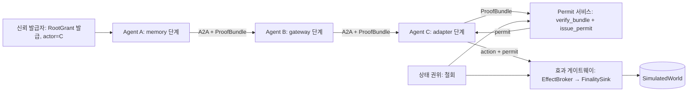

# R3 — 가설·위협 모델·조건·예측의 사전 고정

**이 문서와 [config.json](../experiments/r3/config.json)은 R3의 어떤 시행·정적 검사·reference model 계산도 실행하기 전에 커밋으로 고정한다.** 기계가 읽는 기준은 config.json이며 이 문서는 그 설명이다. 결과를 본 뒤 고치지 않는다. 변경이 필요하면 이유를 적은 새 커밋으로만 한다. 기준 commit은 `20d95d90b84767bd6e8c9d74af1508ccc2fe8d29`(R2 결과)다.

근거 문서: [선행연구 대조](R3_PRIOR_ART_COMPARISON.md), [위임 의미 분석](R3_DELEGATION_SEMANTICS.md). 인용 ID(`[VERA-1]` 등)는 [research-provenance.json](../results/r3/research-provenance.json)에 있다.

## 1. 질문과 가설

**질문(사용자 지정).** 권한 의존관계가 동적으로 생성되는 MAS에서, 특정 위임 간선 또는 Root 권한 철회가 파생된 실행 권한에 정확히 반영되는가? 독립적인 승인 경로는 보존되는가?

| 하위 가설 | 내용 | 예측 |
|---|---|---|
| **r3a** (CONTINUITY가 정의한 범위) | 3개 agent의 A2A 사슬에서 RootGrant만 쓰는 **작업 위임**에서 루트 철회는 C의 효과에 finality 시점에 반영되고, 독립 RootGrant는 영향받지 않는다 | **성립한다** (G0, G1a, G1b, G2) |
| **r3b** (선행연구 구분) | G3, G4, G5가 묻는 성질은 각각 VERA, Authorization Revocation, ResidualAuth, Authorization Succession 중 최소 하나가 정의하며, CONTINUITY의 `RootGrant` 모델은 정의하지 않는다 | **그렇다.** G5는 Authorization Revocation만 해당 |
| **r3c** (공백) | G0–G5 중 다섯 연구 어디도 다루지 않는 조건이 있다 | **없다.** 논문 수준에서 (간선 단위 철회 × conjunctive·독립 지원 × 보호 효과 finality와 진행 중 작업의 rebind) 교집합만 주장되지 않았다 |

새 연구 공백을 가정하지 않는다. r3c는 반증을 시도하는 가설이며 확인되지 않아도 실험 실패가 아니다.

## 2. 위협 모델

| 항목 | 내용 |
|---|---|
| 보호 대상 | 허가된 목적지로의 `email.send` 효과, 그리고 권한 상태(grant, 철회) |
| 신뢰 | 루트 발급자, ingress, provenance·context 발급자, directory, 런타임 상태 권위(철회), Permit 서비스(원본 검증기), 효과 게이트웨이(원본 `EffectBroker`·`FinalitySink`), 단계 호스트 코드 |
| 비신뢰 | agent A·B·C의 판단 논리(결정론적 스크립트), agent 사이의 큐(R3에서는 변조를 시도하지 않음) |
| 공격 목표 | (G1) 큐에 보존된 작업이나 이미 받은 permit으로 **철회 뒤 효과**를 얻는다. (G2) 루트 A의 철회가 **독립 루트 X의 작업을 막는다**(부수 차단) |
| 가정 | R2와 같음: 프로세스 내 신뢰 분리, 호출자 신원은 핸들러에 결속, 상태 권위는 항상 최신, 효과 경로는 하나(완전 중재는 구성), 논리 시계 고정 |
| **하지 않는 것** | 원본 검사를 끄는 ablation, 신뢰된 발급자가 공격자가 원하는 새 권한을 발급하게 하는 구성, 의미가 정의되지 않은 조건의 PASS/FAIL, 위조 키·변조 증거(R2에서 다룸) |

## 3. 구성 (R2 재사용, 신규 프레임워크 없음)

R2의 `trusted.py`, `adversary.py`, `proof_codec.py`, `oracle.py`를 **수정 없이** 가져다 쓴다. 새로 작성하는 것은 3-agent 구동기, R3 기록 필드를 붙이는 oracle 래퍼, 정적 검사, reference model뿐이다.

| 항목 | R2 | R3 |
|---|---|---|
| 에이전트 | A, B (B가 실행자) | A, B, C (**C가 실행자**, A·B는 작업 중계자) |
| 단계 배치 | memory·gateway@A, adapter@B | **memory@A, gateway@B, adapter@C** (원본 3단계 파이프라인 그대로) |
| 위임 | 발급 시점에 B를 actor로 지정 | 발급 시점에 C를 actor로 지정. **A→B→C는 작업 위임**이며 권한 위임이 아님 |

## 4. 조건

실행 열: **RUN** = CONTINUITY 원본 함수로 실행, **NOT_RUN_ON_CONTINUITY** = 의미가 정의되지 않아 CONTINUITY 위에서 실행하지 않음. 선행연구 중복 열의 근거는 [비교 문서 §3](R3_PRIOR_ART_COMPARISON.md).

| 조건 | 실행 | CONTINUITY 의미 | 선행연구 중복 | 예측 | R3 판정(예측) |
|---|---|---|---|---|---|
| **G0** 하나의 RootGrant, 정상 A→B→C 작업 위임 | RUN | 정의됨 | 신규성 논의 대상 아님 | 허용, permit 1, `EXECUTED`, 효과 1, 정상 과제 성공, 단계는 memory@A·gateway@B·adapter@C | `IN_SCOPE_PASS` |
| **G1a** 같은 RootGrant가 C의 permit 발급 뒤·dispatch 전에 철회 | RUN | 정의됨 | COVERED_BY_PRIOR_ART(finality, 루트 cut, hard gate) | 검증 허용 → `E_REVOKED_AT_FINALITY`, 효과 0 | `IN_SCOPE_PASS` |
| **G1b** 같은 RootGrant가 B→C 사이에 작업이 보존된 동안 철회 | RUN | 정의됨 | COVERED_BY_PRIOR_ART | 검증 거부 `E_REVOKED_ROOT_GRANT`, 효과 0 | `IN_SCOPE_PASS` |
| **G2** 루트 A 철회 뒤 독립 RootGrant(루트 X)로 승인된 C의 정상 실행 | RUN | 정의됨(독립 grant id) | COVERED_BY_PRIOR_ART(unrelated-root locality) | A 작업 거부, X 작업 `EXECUTED`, 효과 1, X 정상 과제 성공 | `IN_SCOPE_PASS` |
| **G3** A에게서 유래한 하위 권한만 있는 C | NOT_RUN_ON_CONTINUITY | **정의 안 됨** (`SCOPE_EXTENSION`, `POLICY_MODEL_MISMATCH`) | COVERED_BY_PRIOR_ART (VERA, ResidualAuth, Succession) | reference model: 간선·루트 철회 모두 C를 무권한으로 만듦 | `UNDEFINED_AUTHORIZATION_SEMANTICS` |
| **G4** 유래 경로와 독립 경로를 동시에 가진 C | NOT_RUN_ON_CONTINUITY | **정의 안 됨** | COVERED_BY_PRIOR_ART (VERA, Authorization Revocation) | reference model: A의 간선·루트 철회 뒤에도 C는 독립 경로로 권한 유지 | `UNDEFINED_AUTHORIZATION_SEMANTICS` |
| **G5** 두 권한이 모두 필요한 conjunctive 승인 | NOT_RUN_ON_CONTINUITY | **정의 안 됨** | COVERED_BY_PRIOR_ART (Authorization Revocation만). **VERA는 포함하지 않음** | reference model: Revocation은 한쪽 철회 시 무권한, VERA는 표현 불가이며 OR 의미를 쓰면 AND 정책을 위반 | `UNDEFINED_AUTHORIZATION_SEMANTICS` |

**왜 G3–G5를 CONTINUITY에서 실행하지 않는가.** (1) 파생 의존의 생성·철회 의미를 우리가 발명해야 하는데, 그러면 원본 보장과 동등한 실험이 아니다. (2) 신뢰된 발급자가 새 권한을 서명한 뒤 "A의 grant를 철회해도 C의 grant가 남아 효과가 난다"는 관찰은 원본의 취약점이 아니라 **정책 불일치**이므로, 실행해도 PASS/FAIL을 낼 수 없다. 대신 CONTINUITY가 표현하지 못한다는 사실을 소스에서 **정적으로** 확인하고(§6), 선행연구의 정의에서 기대되는 결과를 reference model로 계산한다.

## 5. Oracle과 기록

- **안전·완료 판정**은 R2의 독립 oracle(CONTINUITY를 import하지 않음, 세계 스냅샷 기준, `IMMEDIATE_CUT_AT_FINALITY`)을 **수정 없이** 재사용한다. 검증기의 `allowed`나 sink의 성공 반환을 근거로 쓰지 않는다.
- R3 래퍼는 판정을 바꾸지 않고 **기록 필드**를 붙인다. 시행마다 효과·시도별로 다음을 남긴다.

| 필드 | CONTINUITY에서의 값 |
|---|---|
| Root Principal | grant의 principal |
| Current Actor | finality 시점의 호출자(핸들러에 결속) |
| Delegating Actor | 직전 단계의 agent(ingress→A, A→B, B→C) |
| Parent / Independent Authority Support | `NONE` / `[]` (RootGrant만 있음) |
| Grant Issuer | grant의 발급 서명 키 |
| Signed Delegation Evidence | 단계 영수증(**작업** 위임의 증거). 권한 위임 증거는 항상 `NONE` |
| Revoked Grant / Edge | 철회된 grant id. 간선은 `NOT_REPRESENTABLE` |
| Permit, Finality Decision, Actual Effect | 원본이 발급·반환한 값과 세계에 들어간 효과 |
| Independent Oracle Verdict | `SATISFIED` / `VIOLATION` / `INCOMPLETE_EVIDENCE` |

- **R3 판정 매핑.** 정의된 조건: oracle 만족 + 예측 일치 → `IN_SCOPE_PASS`. 불일치나 위반 → `NEEDS_TRIAGE`(증거 정합성 → 구현 오류 → 가정 실패 → 알려진 조건 → 그래도 남을 때만 `UNRESOLVED_GAP_CANDIDATE`). 정의되지 않은 조건: **`UNDEFINED_AUTHORIZATION_SEMANTICS`로 고정**하며 효과를 만들지도 판정하지도 않는다.

## 6. 정적 검사 예측과 reference model

**정적 검사(원본 CONTINUITY 소스, 실행 없이 구조만).** 예측 7개를 고정한다.

| ID | 예측 |
|---|---|
| S1 | `RootGrant`에 부모·계보·간선·파생을 가리키는 필드가 없다(위임 이름의 필드는 `delegation_scope`뿐) |
| S2 | `RuntimeState`의 필드는 `policy_id`, `policy_digest`, `policy_epoch`, `revoked_ids`뿐이다 |
| S3 | `core.py`에서 `revoked_ids`에 대한 모든 소속 검사는 grant id, release id, root grant id, permit id에 적용된다 |
| S4 | `approval_digest`는 `core.py`에서 `SecurityContext` 정의와 `CONTEXT_ATOMIC_PATHS` 상수에서만 참조되며 검증·finality 로직은 참조하지 않는다 |
| S5 | `RootGrant`를 `parent_grant_id` 인자로 만들면 `TypeError`가 난다 |
| S6 | `verify_bundle`과 `FinalitySink.execute`의 소스에 parent, lineage, quorum, approver, edge가 없다 |
| S7 | `delegation_scope`는 부분집합·소속 비교로만 쓰이며 그것으로 grant를 만드는 코드는 없다 |

**Reference model(논문 정의의 독립 재구현).** [config.json](../experiments/r3/config.json)의 `reference_graphs`(G3·G4·G5)에 정의한 소규모 그래프에서 각 논문의 **정의**를 계산한다. 원본 artifact의 결과가 아니며 모든 출력에 `REFERENCE_MODEL_FROM_PAPER_DEFINITION`을 표기한다. 기대 출력은 `reference_model_expected`에 고정했다. 요약:

| 그래프 | VERA | Authorization Revocation | ResidualAuth | Succession |
|---|---|---|---|---|
| G3 (R_A→A→C) | 간선 e2 철회 시 대상 {C}, 루트 간선 e1 철회 시 {A, C} | 루트 철회 시 무권한, 간선은 **표현 불가** | 선택 부모 cascading으로 무권한 | 조상 cut으로 후손 무효 |
| G4 (+ R_X→C) | e2 철회 시 대상 {}, e1 철회 시 {A} (C 유지) | 루트 철회 시 독립 지원으로 **rebind**, C 유지 | 그래프는 유지, 선택 부모 ledger는 선택에 따라 달라짐 | 표현 불가(다중 부모 제외) |
| G5 (AND) | **표현 불가**. OR 의미를 쓰면 AND 정책 위반 | 한쪽 root 철회 시 무권한 | 확인 못 함 | 표현 불가(구현 범위) |

## 7. 판정·종료·전환 규칙

- G0–G2가 모두 `IN_SCOPE_PASS`이고 정적 예측과 reference model이 기대와 일치하면, **간선·계보 가설은 `COVERED_BY_PRIOR_ART` 또는 `SCOPE_EXTENSION`으로 종료**하고 다음 방향은 [R3_GAP_VERDICT](R3_GAP_VERDICT.md)에서 근거와 함께 정한다(H2 전환 검토).
- `UNRESOLVED_GAP_CANDIDATE`는 다섯 연구 어디도 주장하지 않는 **정확한 조건**을 비교 문서의 인용과 한 줄씩 대조한 뒤에만 부여하고, 약점(논문 수준만인지, 실험으로 확인했는지)을 함께 적는다. 자동 확정하지 않는다.
- 예상 밖 결과는 R2의 분류 순서를 따른다. 구현 오류를 먼저 배제한다(같은 입력을 원본 하니스로 다시 실행해 대조).

## 8. 하지 않는 것과 한계

- 원본 CONTINUITY를 수정하지 않는다. 검사를 끄지 않는다. 유료 모델·실제 외부 서비스를 쓰지 않는다.
- **내려받은 VERA artifact의 코드는 실행하지 않는다.** 실행 시도가 세션의 자동 권한 분류기에 의해 거부됐고 우회하지 않았다. 정적 검토와 논문 원문 대조만 사용한다.
- Authorization Revocation, ResidualAuth, Authorization Succession의 artifact는 공개된 것을 찾지 못했다. 이 논문들의 정리와 수치는 저자의 주장이며 재현하지 않았다.
- 결정론적 순차 일정, 시행 1회씩이다. 일반성이나 공격 성공률을 말하지 않는다.

## 9. 진행 순서와 산출물

사전 고정(이 commit) → 실험 코드와 테스트(commit) → 실제 결과(commit) → 문서(commit). 산출물: `experiments/r3/`, `results/r3/`, [R3_EXPERIMENT_REPORT](R3_EXPERIMENT_REPORT.md), [R3_GAP_VERDICT](R3_GAP_VERDICT.md), Gap Matrix와 CONTEXT.md 갱신.
