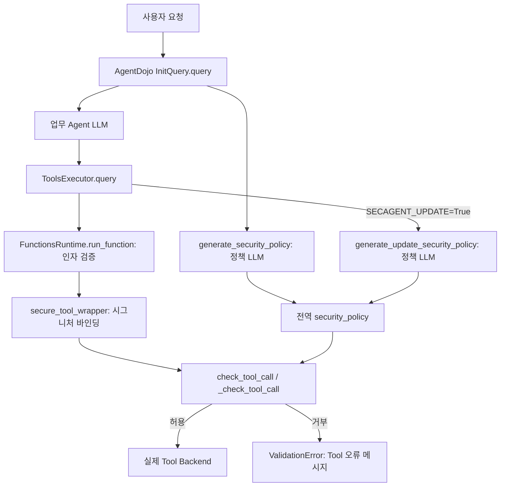

# 원본 Progent 정책 생성·집행 구조

대상은 clean checkout `third_party/progent/`의 `b02783b896d4bf01a2adf24738015e258db8d35b`이다. 아래의 줄 번호는 해당 pin 기준이다. 주요 구현은 [`secagent/tool.py`](https://github.com/sunblaze-ucb/progent/blob/b02783b896d4bf01a2adf24738015e258db8d35b/secagent/tool.py)에 있다.

## 함수와 호출 관계

| 함수/위치 | 원본 구현에서 확인한 동작 |
| --- | --- |
| `update_security_policy`, `tool.py:114-118` | 전달받은 규칙 맵을 전역 `security_policy`에 넣고 정렬. 수동 정책 설정에 재사용 가능 |
| `generate_security_policy`, `tool.py:375-407` | `TOOLS`와 `USER_QUERY`를 정책 LLM에 보냄. 기존 priority 100 생성 규칙을 제거하고 결과를 `(100, 0, args, 0)` 허용 규칙으로 추가. 생성 정책의 사용자 의도 적합성을 검증하는 호출은 없음 |
| `generate_update_security_policy`, `tool.py:435-501` | Tool 호출·결과·기존 생성 제한을 토대로 갱신 후보 생성. `SECAGENT_ONLY_ALLOW_NARROW=True`일 때만 기존 생성 규칙 대비 포함 관계 검사 후 확대 후보 폐기 |
| `check_tool_call`, `tool.py:573-590` | 현재 정책에서 Tool 규칙을 찾고 `_check_tool_call` 호출. 없는 Tool 또는 빈 규칙은 거부; 예외를 Agent용 `ValidationError`로 변환 |
| `_check_tool_call`, `tool.py:521-570` | 정렬된 규칙을 순회하며 인자별 JSON Schema·정규식·callable 조건을 검사. 처음 일치한 Allow는 통과, 일치한 Deny는 예외/종료/사용자 확인. 순회를 끝내면 **마지막 규칙의 fallback** 사용. 다만 priority 100 Allow의 인자 조건이 실패하고 fallback 0이면 그 자리에서 예외를 던짐(`:537-539`) |
| `secure_tool_wrapper`, `tool.py:718-759` | Tool 메타데이터 등록; 호출 시 함수 시그니처 바인딩 및 기본 인자 적용 → `check_tool_call` → 통과 시에만 `tool(*args, **kwargs)` |
| `apply_secure_tool_wrapper`, `tool.py:762-770` | 단일 함수 또는 함수 목록에 위 Wrapper 적용. 질문에 적힌 함수 이름과 실제 이름이 일치함 |

`sort_policy`(`tool.py:64-69`)는 낮은 숫자 priority부터, 같은 priority면 Deny를 Allow보다 먼저 둔다. 기본 조회 도구에 priority 1 Allow를 넣는 원본 suite가 있어, 그 Tool의 priority 100 생성 제약은 앞선 무조건 Allow를 축소하지 못할 수 있다. `generate_security_policy`는 남아 있는 낮은 priority 규칙 뒤에 생성 규칙을 추가하지만 별도 정렬 호출은 하지 않는다. 수동 Deny와 자동 Allow를 임의 순서·충돌까지 안전하게 결합하는 일반 검증기로 간주하지 않는다.

## 실제 적용 지점과 예외

Banking `task_suite.py:39-45`는 `SECAGENT_SUITE=banking`인 경우 `make_function(apply_secure_tool_wrapper(tool))`로 Tool을 등록한다. Workspace/Travel/Slack의 `task_suite.py`도 각 suite flag에서 해당 Wrapper를 설치한다. `InitQuery.query`(`agent_pipeline/basic_elements.py:25`)가 초기 정책 생성 함수를 호출하고, `ToolsExecutor.query`(`agent_pipeline/tool_execution.py:107,121-124`)는 Runtime 실행 후 옵션이 켜져 있으면 정책 갱신을 호출한다. `FunctionsRuntime.run_function`(`functions_runtime.py:281-305`)은 인자를 검증한 다음 감싼 함수를 호출하며 예외를 Tool 오류로 되돌린다.

- `security_policy is None`이면 `check_tool_call`은 경고만 내고 **통과**한다(`tool.py:575-577`). 따라서 새 실험은 정책이 적용됐는지 확인해야 한다. 정책 맵이 있고 Tool 항목이 없으면 거부한다(`:579-581`).
- 직접 `check_tool_call`은 제한 대상 인자가 kwargs에 없으면 그 조건을 건너뛴다(`:531-534`, `:546-549`). 반면 Wrapper 직접 호출은 `sig.bind`가 필수 인자 누락을 먼저 거부하고, AgentDojo Runtime도 Pydantic 인자 검증을 먼저 수행한다. 이 차이를 Phase 2에서 별도 확인해야 한다.
- `security_policy_type_check`(`:121-130`) 본문에는 실제 `check()` 호출이 없다. 갱신 subset 검사는 [`policy_analysis.py:381-457`](https://github.com/sunblaze-ucb/progent/blob/b02783b896d4bf01a2adf24738015e258db8d35b/secagent/policy_analysis.py#L381-L457)에서 생성 priority 100 규칙만 비교하고, JSON Schema 조건에는 Z3 기반 검사를 사용한다. 이는 사용자 의도와의 의미적 일치나 전체 수동·생성 규칙의 충돌 검증이 아니다.
- `update_always_blocked_tools`(`:88-99`)와 수동 `update_security_policy`는 원본에 존재한다. 생성 함수가 낮은 priority의 수동 규칙을 보존하는 코드도 있다(`:397-405`). 그러나 이 사실만으로 관리자 Deny와 자동 생성 정책의 모든 조합이 안전하다고 주장할 수 없다.

## 새 Use Case의 최소 재사용 경로 — 미구현

별도 Adapter에서 상태만 바꾸는 Mock `vm_action(vm_id, action)`을 만들고 `apply_secure_tool_wrapper`를 호출한다. 수동 정책 시험에서는 **원본** `update_security_policy`로 규칙을 설정한 뒤 감싼 함수를 호출하고 Backend 호출 수·상태를 따로 읽는다. 자동 생성 시험은 그 다음 단계에서 `generate_security_policy` 및 업무 Agent 호출을 분리해 관찰한다. 이 계획은 소스 경로 조사 결과일 뿐, 아직 Tool·정책·검증 코드를 작성하거나 실행한 결과가 아니다.

Wrapper는 등록된 Python Tool 호출을 중재한다. SSH, 하위 프로세스, 파일·네트워크 시스템 호출 전체가 이 경계를 반드시 거친다는 근거는 없다. OS·원격 서비스의 집행 여부는 별도 실험 대상이다.
