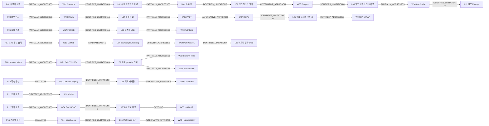
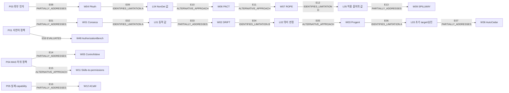
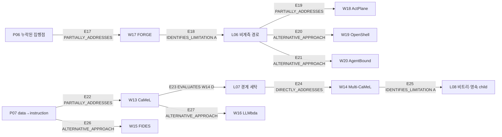
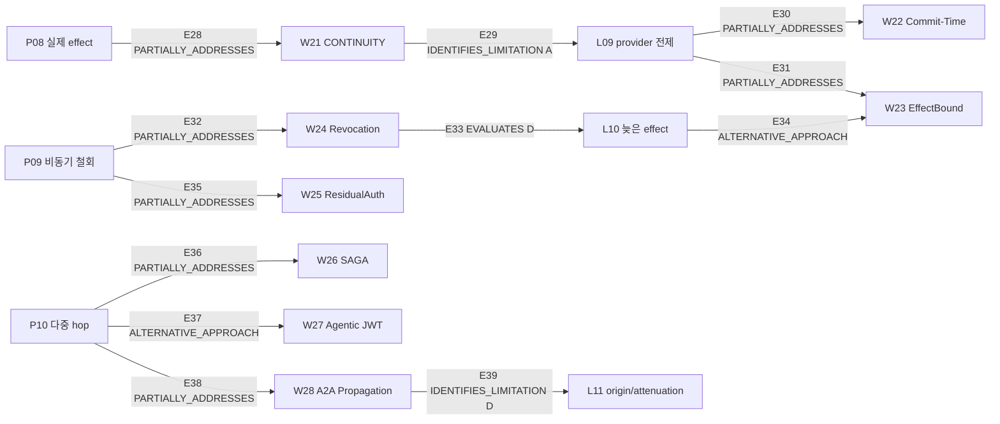
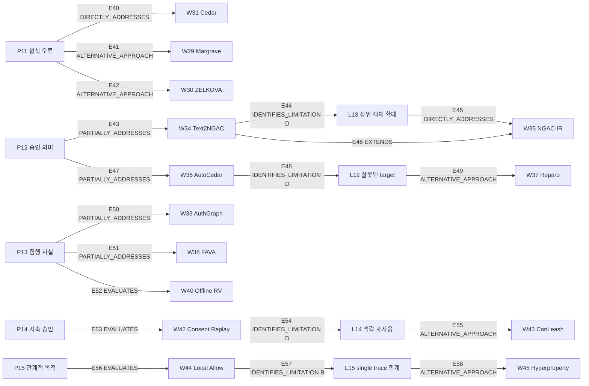

# AI Agent/MAS Access Control 연결 연구 지도

기준일 **2026-11-23**. 이 지도는 논문 목록이나 인용 그래프가 아니라, **문제 → 제안된 해결 → 그 해결의 조건·잔여 한계 → 대응 연구**를 기록한다. `P`는 보호 조건, `W`는 원문/공식 기술, `L`은 구체적 잔여 조건이다. 동일 연구가 여러 `P`에 연결된다. [비교표](limitation_resolution_matrix.md)의 P01–P15와 ID를 맞췄다. 아래 수치는 모두 **저자 보고**이고 이번 조사에서 재현하지 않았다.

근거 등급은 **A** 저자가 명시한 한계, **B** 메커니즘·평가 범위에서 직접 확인되는 제한, **C** 이 조사의 추론, **D** 논문의 시험·반례에서 관찰된 실패다. D도 평가 환경을 벗어난 일반 취약점 증명은 아니다. `DIRECTLY_ADDRESSES`는 문제의 특정 조건을 실제 메커니즘으로 겨냥한다는 뜻이며 완전 해결을 뜻하지 않는다. `EXTENDS`는 실제 방법의 연장을 원문에서 확인한 때만 썼다. 구조상 논문이 한계를 제시했다는 연결에는 `IDENTIFIES_LIMITATION`을 추가했다. 이 표지는 해결 관계가 아니며 A/B/C/D를 반드시 병기한다.

## 조사 경로와 출처 상태

- 연결된 연구 시트 **261018_Controllable_Agent**의 Overview와 Related_works를 **읽기 전용**으로 확인했다. Overview 233행 이후의 Generation / Enforcement / Correctness 비교는 탐색 출발점으로 사용했다. 서지·실험 수치는 시트 대신 원문으로 재검증했다. 로컬 저장소의 기존 조사 문서와 과거 실험 기록은 배경으로만 읽었고 실험은 실행하지 않았다.
- **Backward**: Conseca, CaMeL, FORGE, SAGA, Multi-CaMeL, PAuth 등의 References에서 전통적 access control, capability, IFC 및 agent 선행 방법을 추적했다. **Forward**: Progent 이후의 AuthGraph, PACT, FORGE, Intent Contracts, ACaM 등 후속 연구와 인용 데이터를 대조했다. 인용 여부만 확인된 경우 해결 edge로 취급하지 않았다.
- **동의어·대안**: task scope / operand provenance / argument role / source ownership; tool gate / syscall / provider effect frontier; revocation / residual state / async sink; formal policy inclusion / semantic target 검증 / hyperproperty를 각각 별도로 검색했다. [OAuth RAR RFC 9396 §6.1](https://www.rfc-editor.org/rfc/rfc9396.html)은 구조화된 요청을 허용하지만 API별 `authorization_details` 의미와 일반 비교 연산을 정하지 않는다. 따라서 전통적 OAuth도 의미 정확성의 자동 해답이라고 쓰지 않는다.
- **원문 접근 제한**: [Ghost Approvals DOI](https://doi.org/10.1145/3847352.3848101), [ContractGuard DOI](https://doi.org/10.1145/3830454.3846789), [LEASH DOI](https://doi.org/10.1145/3847352.3848103), [Authorization-Preserving Context Lifecycles SSRN DOI](https://doi.org/10.2139/ssrn.7580538)의 본문은 열지 못했다. 저자 초록·서지만으로 해결·실패 edge를 확정하지 않았다. [SoK: Rethinking Access Control for AI Agents](https://arxiv.org/html/2611.06764) §4–5와 [How Agents Ask for Permission](https://arxiv.org/html/2607.13718) §6은 색인으로 사용하고 개별 메커니즘의 증명으로 쓰지 않았다.

## 문제 노드

| ID | Problem node | 관련 관점 |
|---|---|---|
| P01 | 자연어 task에서 최초 최소권한 정책 및 모호한 대상 결정 | Generation · 의미 정확성 |
| P02 | 실행 중 새 정보에 따른 갱신과 무승인 권한 확대 방지 | Generation · Verification |
| P03 | 외부 정보에서 얻은 민감 인자의 출처와 값 판단 | Generation · Enforcement · 의미 정확성 |
| P04 | MAS 하위 작업의 권한·호출 경로 축소 | Generation · 위임 집행 |
| P05 | tool 설명·skill 절차와 실제 capability/effect 일치 | Generation · Enforcement |
| P06 | tool-call guard 밖 OS·네트워크 효과 집행 | Enforcement |
| P07 | agent 간 비신뢰 데이터의 지시 권위 승격 방지 | Enforcement · IFC |
| P08 | tool 허용과 provider commit/effect의 일치 | Enforcement · 집행 정확성 |
| P09 | 비동기·위임 후 권한 철회와 잔여 effect | Enforcement · 상태 정확성 |
| P10 | A2A 다중 hop caller/origin/attenuation | MAS · 위임 |
| P11 | 형식 정책의 오류·포함·충돌 검증 | 형식 정확성 |
| P12 | 생성 정책과 실제 사용자 뜻의 의미 정합성 | 의미 정확성 |
| P13 | provenance/evidence graph와 관측에 대한 집행 정확성 | 집행 정확성 |
| P14 | 지속 승인 맥락과 정확한 effect의 결속 | Generation · 집행 정확성 |
| P15 | 개별 허용과 전체 실행·관계적 목적 정책 | Enforcement · 형식 정확성 |

## Work 노드: 검증한 서지와 사용 범위

학회 DOI와 `10.48550/arXiv...`는 다르다. 아래에 **arXiv만** 있으면 2026-11-23까지 동료심사 출판을 이 조사에서 확인하지 못했다는 뜻이다. 제목·저자·버전은 연결한 원문/학회 서지에서 확인했다. 긴 저자 명단의 “외”는 원문 링크의 저자 표시를 참조한다.

| ID | 원문 제목·저자 | 검증된 연도·출판 상태/ID | 주로 확인한 위치 |
|---|---|---|---|
| W01 | [Contextual Agent Security: A Policy for Every Purpose](https://arxiv.org/pdf/2501.17070v3), Lillian Tsai, Eugene Bagdasarian | HotOS 2025, DOI [10.1145/3713082.3730378](https://doi.org/10.1145/3713082.3730378), arXiv:2501.17070v3 | §§2–5 |
| W02 | [DRIFT: Dynamic Rule-Based Defense with Injection Isolation for Securing LLM Agents](https://arxiv.org/pdf/2506.12104v3), Hao Li, Xiaogeng Liu, Hung-Chun Chiu, Dianqi Li, Ning Zhang, Chaowei Xiao | NeurIPS 2025, DOI [10.52202/085713-2791](https://doi.org/10.52202/085713-2791); arXiv:2506.12104v3(2026)의 추가 평가와 구별 | §§3–4 |
| W03 | [Progent: Securing AI Agents with Privilege Control](https://arxiv.org/html/2504.11703), Tianneng Shi, Jingxuan He, Zhun Wang, Hongwei Li, Linyu Wu, Wenbo Guo, Dawn Song | arXiv:2504.11703v3, 2026; 초기 “Programmable…” 제목과 구별 | §§3–9, App. D |
| W04 | [Beyond OAuth: Task-Scoped Authorization for AI Agents via Natural Language Slices](https://arxiv.org/pdf/2603.17170v2), Reshabh K Sharma, Linxi Jiang, Shuo Chen, Zhiqiang Lin | PAuth, arXiv:2603.17170v2, 2026; v1 제목과 구별 | §§II–VI, Table III |
| W05 | [Breaking and Fixing Defenses Against Control-Flow Hijacking in Multi-Agent Systems](https://openreview.net/pdf?id=PNU9Rj5RDQ), Rishi Jha, Harold Triedman, Justin Wagle, Vitaly Shmatikov | ControlValve, ICLR 2026; arXiv:2510.17276v2 | §§4–6, Fig. 4 |
| W06 | [The Granularity Mismatch in Agent Security: Argument-Level Provenance Solves Enforcement and Isolates the LLM Reasoning Bottleneck](https://arxiv.org/pdf/2605.11039v1), Linfeng Fan, Ziwei Li, Yuan Tian, Yichen Wang, Rongsheng Li, Xiong Wang | PACT, arXiv:2605.11039v1, 2026 | §§3–4, Table 2 |
| W07 | [ROPE: Routed Origin Policy Enforcement against Indirect Prompt Injection](https://arxiv.org/pdf/2608.27496v2), Xinhang Ma, Chaowei Xiao, William Yeoh, Ning Zhang, Yevgeniy Vorobeychik | arXiv:2608.27496v2, 2026 | §§2–6, Tables 4–5 |
| W08 | [LLM Agent Capabilities Should Follow Task Intent and Context Source](https://arxiv.org/html/2609.14631), Yusheng Zheng, Wenhui Zhang, Yu Mao | IntentCap, arXiv:2609.14631v1, 2026 | §§2–3 |
| W09 | [SPILLWAY: Separating Target Admission from Sanitization to Defend Tool-Using Agents against Prompt Injection](https://arxiv.org/pdf/2611.07222v3), Woosang Lim, Yeseul Chang, Jaewoo Lee | arXiv:2611.07222v3, 2026; 이전 판본의 workshop 상태를 v3 평가에 전가하지 않음 | §§2–5, Tables 2–3 |
| W10 | [CapLite: Prompt-Injection Defense for Small Language Model Agents without Model-Written Security Artifacts](https://arxiv.org/pdf/2611.17115v1), Zimo Xu, Wenzhuo Liu, Hideki Nakayama | arXiv:2611.17115v1, 2026 | §§3, 5, Table 1 |
| W11 | [From Procedures to Permissions: Learning Precise Subagent Authorization from Agent Skills](https://arxiv.org/pdf/2611.08905v1), Wenkai Yu, Ning Ding, Wentao Zhang, Yehui Tang | arXiv:2611.08905v1, 2026 | §§3–4, Table 2 |
| W12 | [ACaM: Automated Capability Modeling for Agentic AI Security](https://arxiv.org/pdf/2611.23507v1), Monika Santra, Dhilung Kirat, Qiushi Wu, Kevin Eykholt, Xiaokui Shu, Ian Molloy | arXiv:2611.23507v1, 2026 | §§3–7 |
| W13 | [Defeating Prompt Injections by Design](https://arxiv.org/html/2503.18813), Edoardo Debenedetti, Ilia Shumailov, Tianqi Fan, Jamie Hayes, Nicholas Carlini, Daniel Fabian, Christoph Kern, Chongyang Shi, Andreas Terzis, Florian Tramèr | CaMeL, arXiv:2503.18813v2, 2025 | §§3–7 |
| W14 | [Can CaMeLs Talk? Securing Multi-Agent Systems Against Indirect Prompt Injection Attacks](https://arxiv.org/html/2610.05640), James Peters-Gill, Avi Semler, Henning Bartsch, Ilia Shumailov, Christian Schroeder de Witt | Multi-CaMeL, arXiv:2610.05640v1, 2026 | §§III–VI, Table III |
| W15 | [Securing AI Agents with Information-Flow Control](https://arxiv.org/html/2505.23643), Manuel Costa, Boris Köpf, Aashish Kolluri, Andrew Paverd, Mark Russinovich, Ahmed Salem, Shruti Tople, Lukas Wutschitz, Santiago Zanella-Béguelin | FIDES, arXiv:2505.23643v2, 2025 | §§3–5 |
| W16 | [The LLMbda Calculus: AI Agents, Conversations, and Information Flow](https://arxiv.org/html/2602.20064), Zac Garby, Andrew D. Gordon, David Sands | arXiv:2602.20064v2, 2026 | §§1–7 |
| W17 | [Formal Policy Enforcement for Agentic Systems](https://arxiv.org/html/2602.16708), Nils Palumbo, Sarthak Choudhary, Jihye Choi, Guy Amir, Prasad Chalasani, Isil Dillig, Somesh Jha | FORGE/SASY, arXiv:2602.16708v4, 2026 | §§3–7, App. H |
| W18 | [ActPlane: Programmable OS-Level Policy Enforcement for Agent Harnesses](https://arxiv.org/html/2606.25189), Yusheng Zheng, Tianyuan Wu, Quanzhi Fu, Tong Yu, Wenan Mao, Tao Ma, Dan Williams, Wei Wang, Andi Quinn | arXiv:2606.25189v2, 2026 | §§2–5 |
| W19 | [NVIDIA OpenShell v0.1.9 공식 정책 문서](https://docs.nvidia.com/openshell/v0.1.9/how-it-works/policies/overview), NVIDIA | 공식 제품 문서, 버전 v0.1.9; 논문·DOI 아님 | Policies, Prover, Security Best Practices |
| W20 | [AgentBound: Securing Execution Boundaries of AI Agents](https://arxiv.org/html/2510.21236), Christoph Bühler, Matteo Biagiola, Luca Di Grazia, Guido Salvaneschi | PACMSE 3 / FSE 2026, DOI [10.1145/3808103](https://doi.org/10.1145/3808103), arXiv:2510.21236v3; 동명 다른 AgentBound와 구별 | §§2–5 |
| W21 | [CONTINUITY: Security-Context Contracts for Composable LLM Agent Controls](https://arxiv.org/html/2609.05269), Chris Zheng, Geng Yang | arXiv:2609.05269v1, 2026 | §§3–8, 12 |
| W22 | [Temporary Authority, Permanent Effects: Commit-Time Authorization for LLM Agents](https://arxiv.org/pdf/2607.10487v2), Igor Santos-Grueiro | arXiv:2607.10487v2, 2026 | §§2–6 |
| W23 | [When Does Authorization End? Effect Closure at Provider Boundaries](https://arxiv.org/html/2609.02866), Igor Santos-Grueiro | EffectBound, arXiv:2609.02866v1, 2026 | §§II–VI, Table III |
| W24 | [Authorization Revocation for Long-Running AI Agents: Root-Scoped Quiescence under Delegation and Asynchronous Execution](https://arxiv.org/html/2609.21284), Genliang Zhu, Chu Wang | arXiv:2609.21284v1, 2026 | §§2–8/Table 6, §10.2/Table 7 |
| W25 | [ResidualAuth: What Authorization State Must Agent Systems Preserve under Revocable Delegation?](https://arxiv.org/html/2609.08062), Moonwon Choi, Seokho Jeong, Sian Choi, Seunggeun Lee | arXiv:2609.08062v2, 2026; v1 제목·저자와 구별 | §§4, 7–8 |
| W26 | [SAGA: A Security Architecture for Governing AI Agentic Systems](https://www.ndss-symposium.org/wp-content/uploads/2026-s869-paper.pdf), Georgios Syros, Anshuman Suri, Jacob Ginesin, Cristina Nita-Rotaru, Alina Oprea | NDSS 2026, DOI [10.14722/ndss.2026.230869](https://doi.org/10.14722/ndss.2026.230869) | §§IV-D/E, VII |
| W27 | [Agentic JWT: A Secure Delegation Protocol for Autonomous AI Agents](https://arxiv.org/html/2509.13597), Abhishek Goswami | arXiv:2509.13597v1, 2025 | §§III–IV, VII |
| W28 | [Authorization Propagation in Agent2Agent Systems: An Experimental Security Evaluation of Multi-Hop Delegation](https://arxiv.org/html/2611.07050), Gabriele Donno, Kashif Mehmood, Katina Kralevska | arXiv:2611.07050v1, 2026 | §§II–V, Table II |
| W29 | [Verification and Change-Impact Analysis of Access-Control Policies](https://web.cs.wpi.edu/~kfisler/Pubs/icse05.pdf), Kathi Fisler, Shriram Krishnamurthi, Leo A. Meyerovich, Michael Carl Tschantz | ICSE 2005, DOI [10.1145/1062455.1062502](https://doi.org/10.1145/1062455.1062502) | §§1–3 |
| W30 | [Semantic-based Automated Reasoning for AWS Access Policies using SMT](https://kasperluckow.com/papers/fmcad2018.pdf), John Backes, Pauline Bolignano, Byron Cook, Catherine Dodge, Andrew Gacek, Kasper Luckow, Neha Rungta, Oksana Tkachuk, Carsten Varming | ZELKOVA, FMCAD 2018, DOI [10.23919/FMCAD.2018.8602994](https://doi.org/10.23919/FMCAD.2018.8602994) | §§I–IV |
| W31 | [Cedar: A New Language for Expressive, Fast, Safe, and Analyzable Authorization](https://arxiv.org/html/2403.04651), Joseph W. Cutler, Craig Disselkoen, Aaron Eline, Shaobo He, Kyle Headley, Michael Hicks, Kesha Hietala, Eleftherios Ioannidis, John Kastner, Anwar Mamat, Darin McAdams, Matt McCutchen, Neha Rungta, Emina Torlak, Andrew Wells | PACMPL 8(OOPSLA1) 2024, DOI [10.1145/3649835](https://doi.org/10.1145/3649835), arXiv:2403.04651v2 | §§2.5–2.6, 4.4 |
| W32 | [ShieldAgent: Shielding Agents via Verifiable Safety Policy Reasoning](https://arxiv.org/html/2503.22738), Zhaorun Chen, Mintong Kang, Bo Li | ICML 2025, [PMLR 267:8313–8344](https://proceedings.mlr.press/v267/chen25ae.html), arXiv:2503.22738v2 | §§3, 5 |
| W33 | [Aligning Provenance with Authorization: A Dual-Graph Defense for LLM Agents](https://arxiv.org/html/2605.26497), Peiran Wang, Ying Li, Yuan Tian | AuthGraph, arXiv:2605.26497v1, 2026 | §§3–5, Table 3 |
| W34 | [Text2NGAC: a multi-LLM pipeline for NGAC policy extraction with mutation-based verification](https://arxiv.org/html/2611.12572), Ayesha Habib, Huixiang Zhang, Dan Zhu, Waiz Haider | arXiv:2611.12572v1, 2026 | §§3, 5.2, Table 15 |
| W35 | [Extracting Next Generation Access Control Policies from Natural Language Using LLMs: An Intermediate-Representation Approach with Back-Translation Verification](https://arxiv.org/html/2611.26941), Ayesha Habib, Huixiang Zhang, Waiz Haider | NGAC-IR, arXiv:2611.26941v1, 2026 | §§1, 3–6, Table 3 |
| W36 | [AutoCedar: An Agentic Framework for Verifier-Guided Access Control Policy Synthesis](https://arxiv.org/html/2607.03656), Adarsh Vatsa, Sachi Shome, Yingming Zhou, William Eiers | arXiv:2607.03656v2, 2026 | §§III, V-D, VI |
| W37 | [Reparo: Synthesizing and Validating Access Control Policies](https://arxiv.org/html/2610.41800), Ayesha Binte Mostofa, Gehao Zhang, Sam Stern, Juan Zhai, Pubali Datta | arXiv:2610.41800v1, 2026 | §§5.2, 7, 9 |
| W38 | [FAVA: Formal Authorization for Verified Agents with Evidence-Backed Permission Graphs](https://arxiv.org/html/2607.27267), Yifan Zhang, Xinkui Zhao, Sai Liu, Hengxuan Lou, Guanjie Cheng, Chang Liu | arXiv:2607.27267v1, 2026 | Method, Finite-Graph Soundness, RQ1/RQ5 |
| W39 | [Agentproof: Static Verification of Agent Workflow Graphs](https://arxiv.org/html/2603.20356), Melwin Xavier, Vaisakh M A, Melveena Jolly, Midhun Xavier | arXiv:2603.20356v1, 2026 | §§5–7, 9 |
| W40 | [Formal Runtime Verification for Tool-Using LLM Agents: An Offline Same-Benchmark Study on AgentDojo and STAC](https://arxiv.org/html/2610.09793), Nikolaos Kekatos, Stylianos Basagiannis, Marinelio Chintri, Alexios Lekidis, Tom Nianios, Ioannis Seitoglou, Anastasios Temperekidis, Panagiotis Katsaros | CPSIoTSec 2026 workshop, DOI [10.1145/3847353.3847499](https://doi.org/10.1145/3847353.3847499), arXiv:2610.09793v1 | §§1, 3–6 |
| W41 | [Approve What, Exactly? Effect Binding and Trusted Rendering for Agent Step-Up Authorization](https://arxiv.org/html/2610.21063), Sai Varun Kodathala, Prashanth Pollishetty, Jaylen Cargill | arXiv:2610.21063v1, 2026 | §§2–8 |
| W42 | [When Consent Outlives Context: Residual Authority Replay in Long-Lived Agents](https://arxiv.org/html/2609.33910), Zhihao Zhang, Chao Wang, Rujia Li, Qingze Wang, Xiaoyan Sun, Jun Dai | arXiv:2609.33910v1, 2026 | §§3, 5–6, Table 3, App. D |
| W43 | [Options, Not Clicks: Lattice Refinement for Consent-Driven MCP Authorization](https://arxiv.org/html/2605.11360), Ying Li, Yanju Chen, Peiran Wang, Isaac Khabra, Faysal Hossain Shezan, Yu Feng, Yuan Tian | ConLeash, arXiv:2605.11360v1, 2026 | §§4–9 |
| W44 | [Local Allow, Global Deny: Why Per-Action Authorization Does Not Compose in LLM Agents](https://arxiv.org/html/2610.27620), Anmol Pandey, Aditya Jain, Liang Chen, Carsten Maple | arXiv:2610.27620v1, 2026; IEEE TPS 2026 채택 확장판, 출판 논문 DOI 미확인 | §§III–IX |
| W45 | [Runtime Enforcement of Hyperproperties](https://arxiv.org/html/2203.04146), Norine Coenen, Bernd Finkbeiner, Christopher Hahn, Jana Hofmann, Yannick Schillo | ATVA 2021, DOI [10.1007/978-3-030-88885-5_19](https://doi.org/10.1007/978-3-030-88885-5_19); arXiv:2203.04146v1은 2022 공개 | §§3–5 |
| W46 | [Intent Contracts: Taking Tools Away from Agents](https://arxiv.org/html/2611.24025), Ziyuan Wang, Genliang Zhu, Xiaobo Chen, Chu Wang | arXiv:2611.24025v1, 2026 | §4, Table 7 |
| W47 | [SkillScope: Toward Fine-Grained Least-Privilege Enforcement for Agent Skills](https://arxiv.org/html/2605.05868), Jiangrong Wu, Yuhong Nan, Yixi Lin, Huaijin Wang, Yuming Xiao, Shuai Wang, Zibin Zheng | ACM CCS 2026, DOI [10.1145/3830454.3846588](https://doi.org/10.1145/3830454.3846588), arXiv:2605.05868v3 | §§2–5 |
| W48 | [Act on Your Behalf, Beyond Your Authorization: Benchmarking LLM Agent Authorization Alignment](https://arxiv.org/html/2610.27548), Zhiping Zhang, Franklin Mingzhe Li, Raio Zihao Huang, Tianshi Li | AuthorizationBench, arXiv:2610.27548v2, 2026; 동료심사 출판 미확인 | §§3–5, App. E |

**서지 주의.** W20은 Docker/MCP 격리 연구이며 [*Behavioral Governance for Autonomous AI Agents: The AgentBound Framework*](https://arxiv.org/html/2606.30970), Anuj Kaul·Qianlong Lan·Pranay Gupta, arXiv:2606.30970v2와 다른 논문이다. 최신 제목·저자가 바뀐 W03, W04, W25는 위 버전 기준이다. W19의 Policy Prover는 [지정된 containment 검증](https://docs.nvidia.com/openshell/v0.1.9/how-it-works/policies/prover)이며 정책 의미나 실제 API 효과의 자동 증명으로 해석하지 않는다.

W02의 세 번째 저자는 [arXiv v3 표지](https://arxiv.org/pdf/2506.12104v3)에 **Hung-Chun Chiu**, [NeurIPS 2025 공식 서지](https://proceedings.nips.cc/paper_files/paper/2025/hash/77f3b26c7907aa27b207df9b9d43f29a-Abstract-Conference.html)에 **CHIU Chun**으로 표시된다. 위 목록은 분석에 사용한 arXiv v3 표기를 따랐고, 출판 판본과의 표기 차이를 기록한다.

## 전체 Map

이 그림은 가장 긴 해결 경로만 보인다. 세부 분기와 모든 edge의 원문 근거는 아래 상세 지도·edge 표에 있다. 회색 L은 **저자 명시/평가 범위/직접 관측** 중 무엇인지 뒤 표에서 확인한다.

## Key Paper의 실제 해결 범위

각 행에서 **정책이 올바르게 주어졌는가**와 **주어진 정책이 제대로 집행됐는가**를 구분한다. 숫자가 없는 행은 효과가 없다는 뜻이 아니라, 이 지도에서 다른 연구와 비교할 만한 동일 조건 수치를 확정하지 않았다는 뜻이다.

| 원문 | 문제·motivating example, threat/trust | 정책 입력·표현, 집행·정확성 주장 | 평가·baseline과 한계 |
|---|---|---|---|
| **W01 Conseca** | 이메일 등 공격자 작성 context가 agent의 목적을 바꾸는 경우. 사용자 요청과 개발자가 정한 trusted context를 신뢰하고 tool 결과는 정책 생성 근거에서 제외([§§2–3](https://arxiv.org/pdf/2501.17070v3)). | 정책 LLM이 task별 API·인자 정규식 규칙과 rationale을 생성; tool 경계에서 결정적으로 검사(§3). | Linux computer-use 합성 20 task×5회: 평균 성공 None 14/20, permissive 12.2/20, Conseca 12/20, restrictive 0([§§4–5/Fig. 3](https://arxiv.org/pdf/2501.17070v3)). **A:** 외부 데이터에 따라 결정해야 할 미래 행동을 trusted-only 정책이 미리 알기 어려움(§3.3). |
| **W02 DRIFT** | 사용자 요청과 충돌하는 도구 결과의 지시가 실행 계획을 바꿈. 사용자 query는 신뢰, 도구 결과는 격리([§3](https://arxiv.org/pdf/2506.12104v3)). | query에서 예상 함수 궤적·인자 의존 checklist; 이탈 시 read는 허용, write/execute는 LLM validator가 task 정합성을 심사하고 isolator가 지시를 숨김(§§3.1–3.3). | AgentDojo·ASB는 [NeurIPS 2025](https://proceedings.nips.cc/paper_files/paper/2025/hash/77f3b26c7907aa27b207df9b9d43f29a-Abstract-Conference.html); AgentDyn은 2026 arXiv v3 추가 평가. v3 AgentDojo GPT-4o-mini ASR 30.7→1.4%, 공격 중 utility 50.9%([§4/Fig. 3](https://arxiv.org/pdf/2506.12104v3)). **B:** write/execute 갱신은 LLM 판단이며 형식적 권한 포함관계 보장이 아님. |
| **W03 Progent** | 정상 요청 중 공격자 tool 결과가 과도한 tool call을 유도. 선의 사용자 요청과 tool schema에서 정책 생성, tool observation은 공격 가능([§§2–3/Fig. 1](https://arxiv.org/html/2504.11703)). | tool/argument allow·forbid와 deny-by-default; tool 호출 전 wrapper; 갱신 후보의 허용 집합이 기존 정책의 부분집합인지 SMT 검사하고 확대는 승인([§§4–7/Alg. 3](https://arxiv.org/html/2504.11703)). 조직/개발자 고정 규칙과 task 규칙도 합성. | AgentDojo GPT-4o ASR 39.9→1.0%, ASB 70.3→3.9%([§8.1/Figs. 3–4](https://arxiv.org/html/2504.11703)). AutoGen MAS §8.3 평가도 있음. **A:** 모호한 초기 요청, 잘못된 사용자 승인, task 내 허용된 선택 조작/최종 텍스트는 보장 밖(§9). 0% Manual Approval ASR은 security-aware 승인자 가정(App. D). |
| **W04 PAuth** | 일반 OAuth operator scope는 “Bob에게 $100”과 다른 목적지를 구분 못함; 일부 연산자는 서버 값 계산이 필요([§§I–II](https://arxiv.org/pdf/2603.17170v2)). | 서명된 명확한 task, 정상 UI/TLS, 올바른 서버 LLM 번역·authoritative 값 신뢰. 서버가 자연어 slice를 imperative code로 번역하고 서명된 operand provenance를 각 실제 서버 호출에서 검사([§III/Figs. 1–5](https://arxiv.org/pdf/2603.17170v2)). | AuthBench 100 task/634 off-task **call 변형**; 원래 AgentDojo 100개 중 71개만 자동 허용, 저자 명확화 뒤 100/100; 634/634은 승인 dialog 발동([§V/Tables II–III](https://arxiv.org/pdf/2603.17170v2)). **A:** NonDet 값은 사용자 확인 또는 재서명된 task 필요(§III-E), 서버 원자성은 전제(§VI). |
| **W05 ControlValve** | 불투명 subagent가 예상과 다른 agent를 호출하는 control-flow hijack. 오케스트레이터는 user task와 agent 목록을 알지만 remote 내부 tool을 보지 못함([§4/Fig. 4](https://openreview.net/pdf?id=PNU9Rj5RDQ)). | 사용자·agent 정보로 CFG와 edge 자연어 규칙을 사전 생성; 실행 시 parser가 agent 순서, LLM judge가 edge-rule 일치를 검사(§4). | Magentic-One CFH-Hard 16 task와 AgentDojo Slack 21 task에서 방어 비교([§6/Tables 1–4](https://openreview.net/pdf?id=PNU9Rj5RDQ)). **A:** 생성 CFG의 과허용/과제약. **D:** 비적대적 “INTERNAL ONLY” 자료 외부 메일 포함 13%, undefended 56%(§6.6); 해당 6 task 조건에 한정. |
| **W17 FORGE/SASY** | agent/여러 agent의 호출 이력·비신뢰 출처·상태에 따라 현재 행동 허용 여부가 달라짐([§§2–3](https://arxiv.org/html/2602.16708)). | 사용자가 Datalog 정책을 지정; 신뢰한 instrumentation의 event graph·may-depend provenance를 SASY monitor가 tool dispatch/HTTP join point에서 검사([§§3–4](https://arxiv.org/html/2602.16708)). 정형 결정은 완전 매개와 충실한 fact에 상대적. | AgentDojo Table 4 provenance 정책 effect ASR 0.2±0.12%, benign utility 62.5±1.4%; IFC 정책 0.3±0.2%, 33.2±1.89%([§5/Table 4](https://arxiv.org/html/2602.16708)). **A:** raw socket/stdio·advised method 내부 동시성 등 비계측 경로와 정책 번역 오류(§7.1, App. H). App. H.3/Table 9의 잘못된 허용 취소 거부는 **D**. |
| **W33 AuthGraph** | prompt injection이 clean user request와 다른 tool/parameter provenance를 만들 수 있음. 원 요청·시스템·tool catalog는 공격자가 바꾸지 못함([§3](https://arxiv.org/html/2605.26497)). | clean-context Planner의 authorization graph와 실행 trace reasoning/provenance graph를 비교, 재계획은 whitelist 범위에 제한([§§3.1–3.4](https://arxiv.org/html/2605.26497)). | AgentDojo GPT-4o ASR .40→.01, 무공격 utility .79→.76; AgentDyn ASR .39→.02([§4/Table 3](https://arxiv.org/html/2605.26497)). **A:** LLM attribution 오류, single-agent 범위(§5); 승인된 출처의 내용 진실성은 증명 아님. |
| **W14 Multi-CaMeL** | 각각 보호된 agent라도 부모가 비신뢰 DB 결과를 child의 trusted message로 넣으면 지시가 세탁됨([§III](https://arxiv.org/html/2610.05640)). | tree/fresh child/단방향 위임 아래 trusted message와 untrusted variables 분리, capability/provenance 전파([§IV](https://arxiv.org/html/2610.05640)). | MultiAgentDojo Table III 949 injected instance/model-config에서 평균 individual ASR 0.2%, multi 0([§V/Table III](https://arxiv.org/html/2610.05640)). **A:** multi-parent, persistent child, async queue, peer cycle은 미평가(§VI); 비자명한 인가 정책은 의도적으로 미사용(§II). |
| **W21 CONTINUITY** | 한 계층의 승인·출처가 변환/위임/시간 경과 후 effect까지 유지되는지 문제([§§1–3](https://arxiv.org/html/2609.05269)). | signed root grant, 필드별 provenance, transformation witness, current policy/revocation, single-use permit을 최종 effect 지점에서 검사([§§3–6](https://arxiv.org/html/2609.05269)). | 32 fault class×4 domain×20=2,560 synthetic 공격, 700 benign, 200 ambiguous; 완전 reference 설정은 이 시험에서 harmful effect 0([§8/Table 3](https://arxiv.org/html/2609.05269)). 비교 6개는 기존 제품 재구현이 아닌 불완전 reference 구성. **A:** semantic validator, manifest, 실제 provider semantics는 전제·미시험(§12). |
| **W18 ActPlane** | tool-level 경계를 지나지 않는 process/file/network 효과를 다룸([§2](https://arxiv.org/html/2606.25189)). | 상위 정책을 BPF-LSM hook에 로드하고 process tree에 file/network/exec 규칙, IFC label, temporal gate 적용(§3). `block`과 `kill`/관찰은 효과가 다름. | 190 traces DCR 75.8%, FIDES 48.9% 비교([§5.2](https://arxiv.org/html/2606.25189)). 607 생성 정책 compile 성공은 사용자 뜻 보증 아님; 66%는 `notify`이며 차단 정책 아님(§5.1). |
| **W19 OpenShell** | sandbox 안의 프로세스·파일·네트워크 경계([정책 개요](https://docs.nvidia.com/openshell/v0.1.9/how-it-works/policies/overview)). | Landlock·UID 및 proxy/OPA 정책, L7 method/path 가능. Advisor 제안은 사람 검토, Prover는 지정 boundary의 정책 containment 확인([Prover](https://docs.nvidia.com/openshell/v0.1.9/how-it-works/policies/prover)). | [보안 지침](https://docs.nvidia.com/openshell/v0.1.9/security/best-practices)에 따르면 L7 `audit`는 기록 후 통과이며 `enforce`가 차단. `protocol`을 설정하지 않으면 method/path 조건이 적용되지 않을 수 있다. 제품 문서의 보장을 다른 version 또는 task 최소권한 증명으로 확대하지 않는다. |
| **W31/W36 Cedar·AutoCedar** | 정해진 승인 target에 대한 형식 검증과 그 target 자체의 정당성이 다른 문제([Cedar §§2.5–2.6](https://arxiv.org/html/2403.04651), [AutoCedar §III](https://arxiv.org/html/2607.03656)). | Cedar schema/type·SMT 포함/동치/반례; AutoCedar는 검토된 atom target과 생성 policy를 비교. | AutoCedar 독립 gold 200건 중 178건 동치. target 검사를 통과한 197건 중 19건은 target이 gold와 달라 정책도 틀림([§V-D/Table VI](https://arxiv.org/html/2607.03656), **D**); 형식 오류 방어와 의미 오류 방어를 분리해야 한다. |

## Limitation 노드

| ID | 잔여 조건과 증거 등급 | 판정의 경계 |
|---|---|---|
| L01 | Conseca trusted-only 사전 정책은 새 외부 데이터로 정해지는 행위를 미리 열거하기 어려움(**A**, [§3.3](https://arxiv.org/pdf/2501.17070v3)) | DRIFT/Progent/PAuth가 서로 다른 전제에서 동적 값·갱신을 처리 |
| L02 | DRIFT write/execute 경로 편입의 핵심 판단은 LLM validator(**B**, [§3.2](https://arxiv.org/pdf/2506.12104v3)) | 실제 공격 성공 D를 이 기계적 범위와 혼동하지 않음 |
| L03 | 최초 정책 또는 확대를 승인한 사람의 범위가 사용자 실제 뜻과 다를 수 있음(**A**, [Progent §9/App. D](https://arxiv.org/html/2504.11703)) | 형식 포함관계는 틀린 최초 target을 교정하지 않음 |
| L04 | 외부 텍스트에만 있는 NonDet 권한 인자는 사용자 확인·task 재서명 필요(**A**, [PAuth §III-E](https://arxiv.org/pdf/2603.17170v2)) | 자동 지급이 필수라는 전제를 넣으면 판정이 달라짐 |
| L05 | 허용된 출처가 공격자 쓰기 가능할 때 값의 적절함이 모호: 공격 7건 성공, source delegation 정상 거부 83건(**D**, [ROPE §5/Tables 4–5](https://arxiv.org/pdf/2608.27496v2)) | 출처 진위와 내용의 정당성을 분리 |
| L06 | raw socket/stdio, advised method 내부 concurrency 등 비계측 이벤트(**A**, [FORGE §7.1](https://arxiv.org/html/2602.16708)) | 하위 OS/network/provider PEP 대안 존재 |
| L07 | 보호된 개별 agent의 조합에서 비신뢰 결과가 trusted child message로 세탁됨(**D**, [Multi-CaMeL §III](https://arxiv.org/html/2610.05640)) | CaMeL 원논문의 모든 설정에 대한 실패는 아님 |
| L08 | Multi-CaMeL의 multi-parent·persistent child·async queue·peer cycle 미평가(**A**, [§VI](https://arxiv.org/html/2610.05640)) | 그 조건의 공격 성공 D는 미확인 |
| L09 | 실제 provider frontier·정확한 manifest/validator가 reference 평가 밖(**A/B**, [CONTINUITY §12](https://arxiv.org/html/2609.05269)) | CTA/EffectBound가 일부 대안 |
| L10 | provider가 이미 수용한 비동기 작업은 cancellation/root cut만으로 effect가 닫히지 않음(**D**, [Authorization Revocation §8](https://arxiv.org/html/2609.21284)) | sink fence·carrier accounting의 대상 |
| L11 | 공유 HMAC 중간 agent가 origin evidence를 다시 만들고, scope inclusion 검사가 빠진 경우(**D**, [Donno et al. §V/Table II](https://arxiv.org/html/2611.07050)) | 독립 origin signature+attenuation의 일반 불가능성은 미입증 |
| L12 | AutoCedar의 reviewed target 자체가 gold와 달라 19/197 target-passing policy 오정합(**D**, [§V-D](https://arxiv.org/html/2607.03656)) | 원래 target이 올바르면 SMT 검사가 강력 |
| L13 | Text2NGAC의 parent-entity 확대 변이 11/120만 탐지(**D**, [§5.2/Table 15](https://arxiv.org/html/2611.12572)); NGAC-IR은 남은 오류 5/31(**D**, [§5.3](https://arxiv.org/html/2611.26941)) | 후속 연구가 실제로 범위 오류를 개선하나 완전하지 않음 |
| L14 | 지속 grant의 exact-resource matching에서도 일부 replay 성공, 실제 코딩 agent 55건에서 ASR 평균 +24.9pp(**D**, [Consent Replay §§5.3–5.4/Table 3](https://arxiv.org/html/2609.33910)) | PAuth 비교는 task-scoping 재구현만; ConLeash·CTA 대안 있음 |
| L15 | 관계적 purpose 조건은 거짓 양성 없는 single-trace 판정기가 완전 탐지할 수 없다는 정리(**B**, [Local Allow §V](https://arxiv.org/html/2610.27620)) | Coenen의 multi-trace 방식과 secure multi-execution이 대안 |

## 상세 Map A — 정책 생성, 갱신, 외부 값

| Edge | 관계와 원문 근거 | 다음에 남는 질문 |
|---|---|---|
| E01 P01→W01 | `PARTIALLY_ADDRESSES`: [Conseca §3.1–3.3](https://arxiv.org/pdf/2501.17070v3)는 trusted context로 per-task API/인자 제약을 만든다. | 사용자 요청이 모호하면 정당한 대상은 별도 확인. |
| E02 W01→L01 | `IDENTIFIES_LIMITATION` **A**: [Conseca §3.3/§5](https://arxiv.org/pdf/2501.17070v3)가 후속 데이터 의존 action과 현실 ground truth를 한계로 명시. | 권한 근거가 공격자 관측으로 확대되면 안 됨. |
| E03 L01→W02 | `PARTIALLY_ADDRESSES`: [DRIFT §3.1–3.3](https://arxiv.org/pdf/2506.12104v3)는 예상 경로를 벗어난 read/write/execute를 실행 중 재평가. | 검증자 판단의 근거·정확성. |
| E04 W02→L02 | `IDENTIFIES_LIMITATION` **B**: [DRIFT §3.2](https://arxiv.org/pdf/2506.12104v3)의 write/execute validator는 자연어 정합성 LLM, 정책 집합의 형식 포함 검사가 아님. | 이는 기능 한계이지 DRIFT의 공격 성공을 새로 재현한 D가 아님. |
| E05 L02→W03 | `ALTERNATIVE_APPROACH`: [Progent §§4.3, 6/Alg. 3](https://arxiv.org/html/2504.11703)은 갱신 후 허용 집합의 확대 여부를 SMT로 판정하고 승인 경계로 보낸다. | “승인 없이 확대되지 않는다”와 “승인이 옳다”는 다름. |
| E06 W03→L03 | `IDENTIFIES_LIMITATION` **A**: [Progent §9/App. D](https://arxiv.org/html/2504.11703)는 잘못된 초기 정책·모호한 요청과 security-aware manual approver 전제를 기술. | 올바른 target 지정. |
| E07 L03→W36 | `PARTIALLY_ADDRESSES`: [AutoCedar §III/§V-D](https://arxiv.org/html/2607.03656)는 검토한 target atom에 대해 생성 Cedar policy 동치를 검사. | target 자체가 잘못되면 W36도 그대로 틀린 정책을 검증(L12). |
| E08 P03→W04 | `PARTIALLY_ADDRESSES`: [PAuth §III-C–D/Figs. 1–5](https://arxiv.org/pdf/2603.17170v2)의 task slice와 signed operand envelope가 서버 인자를 좁힘. | authoritative 값·서버 번역의 신뢰. |
| E09 W04→L04 | `IDENTIFIES_LIMITATION` **A**: [PAuth §III-E](https://arxiv.org/pdf/2603.17170v2)는 오직 파일 내용/모델 추론에 있는 수신자 같은 NonDet 값에 승인·재서명을 요구. | 확인 없이 값을 자동 수용해야 하는 요구가 정당한지. |
| E10 L04→W06 | `ALTERNATIVE_APPROACH`: [PACT §3.1–3.5](https://arxiv.org/pdf/2605.11039v1)는 전체 call이 아니라 argument role별 provenance와 trusted discharge를 검사. | role/출처 label과 discharge가 정확해야 함; PAuth의 임의 free-text NonDet 값을 추가 확인 없이 자동 승인한 증거는 아님. §3.4 추정 정확도 제한. |
| E11 W06→W07 | `ALTERNATIVE_APPROACH`: [ROPE §§2–3](https://arxiv.org/pdf/2608.27496v2)는 사용자 지정 인증 source·record의 origin을 argument별로 라우팅. PACT의 기법을 구현 확장했다는 근거는 없음. | 출처가 진짜여도 그 값이 적절한가. |
| E12 W07→L05 | `IDENTIFIES_LIMITATION` **D/A**: [ROPE §5/Tables 4–5, §6](https://arxiv.org/pdf/2608.27496v2)은 attacker-writable bill/file에 위임된 값에서 공격 성공 7건과 정상 거부 83건을 보고하고 value appropriateness를 보장하지 않는다고 명시. | 다른 연구가 **동일** 조건을 푸는지 확인. |
| E13 L05→W09 | `PARTIALLY_ADDRESSES`: [SPILLWAY §§2–3/Fig. 2](https://arxiv.org/pdf/2611.07222v3)는 typed identity field와 제한된 위임·sanitized review로 free-text 목적지 오염을 줄인다. | typed field가 공격자 제어인 ROPE 사례와 동일 조건 실험은 아님. |
| E14 P04→W05 | `PARTIALLY_ADDRESSES`: [ControlValve §4/Fig. 4](https://openreview.net/pdf?id=PNU9Rj5RDQ)는 opaque subagent의 CFG와 호출 edge 규칙을 사전 생성해 실행 경로 심사. | 내부 tool 효과는 그 환경에서 불투명; §6.6의 accidental leak 13% D. |
| E15 P04→W11 | `ALTERNATIVE_APPROACH`: [From Procedures to Permissions §§3–4/Table 2](https://arxiv.org/pdf/2611.08905v1)는 skill 절차에서 subagent permission을 추정; W05의 호출 그래프와 다른 policy 대상. | 학습한 범위의 실제 의미와 runtime PEP 필요. |
| E16 P05→W12 | `PARTIALLY_ADDRESSES`: [ACaM §§3–7](https://arxiv.org/pdf/2611.23507v1)는 Python code path에서 capability graph를 추출하고 43 agents 중 9 MAS를 평가. | source가 안 보이는 remote service와 동적 효과는 원문 범위 밖. |
| E59 P01→W48 | `EVALUATES`: [AuthorizationBench §§3–4](https://arxiv.org/html/2610.27548)는 승인 계약이 명시된 286 task, 4모델×2 reasoning×3 harness의 6,864 trajectory에서 기본 agent의 범위 밖 행동 19.2%를 보고. | 접근통제 **방어법** 평가가 아니다. §5/App. A는 구성된 환경·짧은 horizon, App. E는 판단 검증 범위를 밝힌다. |

**반박 경로.** [IntentCap §§2–3](https://arxiv.org/html/2609.14631)은 값의 source별 field ownership과 parent ceiling을, [CapLite §§3, 5/Table 1](https://arxiv.org/pdf/2611.17115v1)는 user-exact authority 값과 미기재 값 확인을, [CXI §§2–3](https://arxiv.org/pdf/2607.06000v1)는 typed release를 제안한다. 따라서 “동적 값은 정책으로 표현·집행할 수 없다”는 넓은 주장은 기각한다. [Intent Contracts §4/Table 7](https://arxiv.org/html/2611.24025)는 trusted executor가 있어도 모호한 target에서 자체 평가 29/96 비인가 동작을 보고(**D**). 다른 방법의 실패율로 옮기지 않는다. [SkillScope §§2–6](https://arxiv.org/html/2605.05868)는 skill의 task-conditioned 과권한을 분석·분리/guard하므로 P05가 단순 공백은 아니다.

## 상세 Map B — tool, OS, 정보 흐름, MAS 경계

| Edge | 관계와 원문 근거 | 범위 |
|---|---|---|
| E17 P06→W17 | `PARTIALLY_ADDRESSES`: [FORGE §§3–4](https://arxiv.org/html/2602.16708)는 tool dispatch/HTTP weaving join point에서 Datalog history·provenance 정책을 집행. | 계측한 후보 행동과 사실에 상대적. |
| E18 W17→L06 | `IDENTIFIES_LIMITATION` **A**: [FORGE §7.1](https://arxiv.org/html/2602.16708)은 raw socket, direct stdio, advised method 내부 동시성 등으로 graph가 불완전할 수 있음을 명시. | 그 경로의 무조건적 공격 성공 D가 아님. |
| E19 L06→W18 | `PARTIALLY_ADDRESSES`: [ActPlane §§2.3, 3](https://arxiv.org/html/2606.25189)의 BPF-LSM은 file/network/exec의 process-tree 효과를 hook에서 본다. | business API의 의미·응답 content는 별도. |
| E20 L06→W19 | `ALTERNATIVE_APPROACH`: [OpenShell v0.1.9 정책](https://docs.nvidia.com/openshell/v0.1.9/how-it-works/policies/overview)의 Landlock·proxy/OPA, [보안 지침](https://docs.nvidia.com/openshell/v0.1.9/security/best-practices)의 L7 enforce 조건. | `audit`는 차단 아님; 지정 정책 containment와 실제 task 의미는 다름. |
| E21 L06→W20 | `ALTERNATIVE_APPROACH`: [AgentBound §§2–5](https://arxiv.org/html/2510.21236)는 MCP server별 Docker filesystem/network 경계를 매니페스트로 적용. | 허용망 안의 악성 SQL 인자는 §5에서 범위 밖. |
| E22 P07→W13 | `PARTIALLY_ADDRESSES`: [CaMeL §§5–6](https://arxiv.org/html/2503.18813)는 trusted query에서 control/data flow를 프로그램화하고 값별 capability를 interpreter에서 강제. | 원문 §3/§7의 threat model과 side-channel 조건. |
| E23 W13→L07 | `EVALUATES` **D**: [Multi-CaMeL §III](https://arxiv.org/html/2610.05640)가 개별 CaMeL agent 조합의 SQL-result→trusted-child-message 세탁을 보여준다. | W13 저자가 모든 MAS를 보호한다고 주장한 것의 반박으로 쓰지 않음. |
| E24 L07→W14 | `DIRECTLY_ADDRESSES`: [Multi-CaMeL §IV](https://arxiv.org/html/2610.05640)는 trusted `message`/untrusted `variables`를 분리하고 provenance/capability 전파. | §V/Table III 949 injected task instances/model-config의 결과로 범위 제한. |
| E25 W14→L08 | `IDENTIFIES_LIMITATION` **A**: [Multi-CaMeL §VI-A, “Beyond Trees”](https://arxiv.org/html/2610.05640)는 multiple parents, persistent child, async queue, peer cycle을 다음 과제로 명시. | 이 조건의 공격 성공 D는 이 논문에 없음. |
| E26 P07→W15 | `ALTERNATIVE_APPROACH`: [FIDES §§3–5](https://arxiv.org/html/2505.23643)는 agent-tool 경계에 confidentiality/integrity label과 제한된 quarantined LLM query를 사용. | 정확한 label·policy·release 범위 필요. |
| E27 W13→W16 | `ALTERNATIVE_APPROACH`: [LLMbda §§1–5](https://arxiv.org/html/2602.20064)는 untaken branch의 implicit dependence와 외부 retry loop를 다루는 TIPNI calculus/Lean interpreter를 제안. | Multi-parent 지속 MAS를 직접 해결했다는 edge가 아님. |

여기서 tool-only 계측의 누락은 OS·proxy·provider 계층이 이미 다룰 수 있다. [Progent §8.3](https://arxiv.org/html/2504.11703)의 MAS tool gate도 있으므로 “Progent는 MAS에서 집행할 수 없다”는 주장은 부정확하다. 반대로 OS 경계만으로는 payee, reviewed commit SHA, 사용자 목적 같은 비즈니스 의미를 자동으로 알 수 없다. 어느 정보가 부족한지 먼저 고정해야 한다.

## 상세 Map C — provider effect, 철회, 다중 hop 위임

| Edge | 관계와 원문 근거 | 범위·반박 |
|---|---|---|
| E28 P08→W21 | `PARTIALLY_ADDRESSES`: [CONTINUITY §§3–6](https://arxiv.org/html/2609.05269)는 signed root grant→field provenance→transformation witness→single-use permit을 final effect에서 확인한다. | §8의 2,560 attack instance는 설계된 synthetic conformance 시험. |
| E29 W21→L09 | `IDENTIFIES_LIMITATION` **A/B**: [CONTINUITY §12](https://arxiv.org/html/2609.05269)는 semantic validator, manifest completeness, 실제 provider 동시성·부분 실패 통합을 보장 밖으로 명시. | 실제 제품 실패 D라는 뜻 아님. |
| E30 L09→W22 | `PARTIALLY_ADDRESSES`: [Commit-Time Authorization §§2–4](https://arxiv.org/pdf/2607.10487v2)는 exact effect/current grant/premise/dependency/binding을 atomic sink에서 검증한다. | §6은 정책에 빠진 사실·semantic validator의 진실성 및 우회한 sink를 보장하지 못함. |
| E31 L09→W23 | `PARTIALLY_ADDRESSES`: [EffectBound §§II–V/Table III](https://arxiv.org/html/2609.02866)는 provider effect frontier의 제어 능력을 분석·시험. GitHub native REST의 reviewed SHA 결속은 MCP 표면 결핍의 대안; Kafka 4.3.1 고정 경로에 fence 구현. | semantic validator의 진실성과 모든 provider path inventory·manifest의 완전성은 검증하지 않음(§VI). |
| E32 P09→W24 | `PARTIALLY_ADDRESSES`: [Authorization Revocation §§2–5](https://arxiv.org/html/2609.21284)는 root epoch cut 후 queue/callback/provider carrier를 fence·완결/재결속하고 certificate로 quiescence를 구분. | 17-case provider-free reference suite(§§7–8); 이미 발생한 효과 rollback 아님. |
| E33 W24→L10 | `EVALUATES` **D**: [Authorization Revocation §8.1/Table 6](https://arxiv.org/html/2609.21284)의 cancellation-only/root-cut-only 구성에서는 늦은 효과가 남고, cut+fence 구성은 막는다. | 이 논문은 L10의 해결 메커니즘도 제시; L10을 “W24의 실패”로 읽지 않음. |
| E34 L10→W23 | `ALTERNATIVE_APPROACH`: [EffectBound §§II, V-C](https://arxiv.org/html/2609.02866)는 policy-relevant provider effect 경로의 closure를 별도 단위로 정의하고 Kafka fence를 시험. | root-scoped quiescence와 같은 목표 술어는 아님. |
| E35 P09→W25 | `PARTIALLY_ADDRESSES`: [ResidualAuth §4/Theorem 1, §7/Fig. 2](https://arxiv.org/html/2609.08062)는 현재 reachability가 같아도 revoke 뒤 결과가 다를 수 있음을 증명. fresh authenticated decision은 15–16/16 pairs, 256-token summary 0–2/16; hard gate는 시험의 unauthorized effect 8→0. | grant-state 정보 요건·판단·effect gate를 분리. §8의 제한된 graph semantics 및 reference ledger에 한정. |
| E36 P10→W26 | `PARTIALLY_ADDRESSES`: [SAGA §IV-D/E, pp. 6–8](https://www.ndss-symposium.org/wp-content/uploads/2026-s869-paper.pdf)는 Provider의 agent contact policy·one-time key·task-scoped contact token으로 상대 접촉을 제한. | contact 허용이 downstream tool argument attenuation은 아님. |
| E37 P10→W27 | `ALTERNATIVE_APPROACH`: [Agentic JWT §§III–IV](https://arxiv.org/html/2509.13597)는 intent/workflow token, delegation assertion, proof-of-possession을 설계. | §VII의 prompt evaluation TOCTOU/배포 전제 및 후속 정량 평가 계획을 명시. |
| E38 P10→W28 | `PARTIALLY_ADDRESSES`: [Donno et al. §§II–V/Table I–II](https://arxiv.org/html/2611.07050)는 current caller, origin authority, per-hop request, replay domain을 분리해 4-party synthetic A2A를 시험. | §III의 자체 제안 메커니즘이며 §V/Table II에서 14/15 adversarial condition 거부; 남은 1건은 isolated scope-widening test. |
| E39 W28→L11 | `IDENTIFIES_LIMITATION` **D**: [Donno et al. §V-A–B](https://arxiv.org/html/2611.07050)에서는 scope inclusion 미검사와 공유 HMAC 중간자의 origin evidence 재작성; 후자는 full application check 통과. | 독립 키 origin 서명+per-hop narrowing을 적용한 모든 프로토콜의 실패는 아님. |

**해결 관계의 주의.** W21, W22, W23, W24는 서로의 논문을 그대로 확장한 단일 체인이 아니다. 각각 *한 효과의 permit*, *원자적 commit*, *provider effect frontier*, *root 전체의 비동기 carrier*라는 서로 다른 술어를 다룬다([CONTINUITY §§3–6](https://arxiv.org/html/2609.05269), [Commit-Time §§2–4](https://arxiv.org/pdf/2607.10487v2), [EffectBound §II](https://arxiv.org/html/2609.02866), [Revocation §9](https://arxiv.org/html/2609.21284)). W25는 그 판단에 필요한 과거 grant 상태의 정보량을 보여 주지만 실제 서비스 전체의 상태를 인증해 주지는 않는다. [RFC 8693 OAuth token exchange](https://www.rfc-editor.org/rfc/rfc8693.html)와 capability attenuation도 W28의 공유 키 설계에 대한 강한 반박 경로다. 동일 A2A 조건의 직접 비교는 미확인이다.

## 상세 Map D — 형식·의미·집행 정확성과 전체 목적

| Edge | 관계와 원문 근거 | 정확한 해석 |
|---|---|---|
| E40 P11→W31 | `DIRECTLY_ADDRESSES`: [Cedar §§2.5–2.6, 4.4](https://arxiv.org/html/2403.04651)의 schema/type, SMT policy inclusion/equivalence/반례. | 주어진 정책 언어·명세에 대한 형식 보장. |
| E41 P11→W29 | `ALTERNATIVE_APPROACH`: [Margrave §§1–3](https://web.cs.wpi.edu/~kfisler/Pubs/icse05.pdf)는 XACML subset의 policy property/change-impact 분석. | agent 신기능을 요구하지 않는 기존 해법. |
| E42 P11→W30 | `ALTERNATIVE_APPROACH`: [ZELKOVA §§I–IV](https://kasperluckow.com/papers/fmcad2018.pdf)는 IAM policy를 SMT로 인코딩해 관계 검사. | 일반 자연어 의미까지 증명하는 것은 아님. |
| E43 P12→W34 | `PARTIALLY_ADDRESSES`: [Text2NGAC §§3, 5](https://arxiv.org/html/2611.12572)는 문장 근거로 NGAC 관계를 추출·구조/변이 검사. | 문법·구조 유효성과 의미 범위는 다름. |
| E44 W34→L13 | `IDENTIFIES_LIMITATION` **D**: [Text2NGAC §5.2/Table 15](https://arxiv.org/html/2611.12572)의 parent-entity abstraction 변이 120건 중 11건만 탐지. | 저자의 sentence-grounded review routing이 114/120을 flag한다는 반박도 기록. |
| E45 L13→W35 | `DIRECTLY_ADDRESSES`: [NGAC-IR §§4, 5.3/Table 6](https://arxiv.org/html/2611.26941)은 Text2NGAC의 **동일한 상위 resource 변이 120개**를 back-translation으로 재평가해 109개(90.8%)를 찾았다. Grammar-constrained IR·deterministic compilation은 §§1, 3의 방법이다. | Text2NGAC의 별도 특화 heuristic도 114/120을 flag했다. NGAC-IR의 자체 추출 실제 오류는 별도 지표로 31개 중 26개 탐지, 5개 미탐지(§5.3); 완전 해결 아님. |
| E46 W34→W35 | `EXTENDS`: [NGAC-IR §1/§3](https://arxiv.org/html/2611.26941)이 같은 팀 Text2NGAC 구조 검사의 한계를 명시하고 IR/back-translation을 추가. | 실제 후속 확장 관계 확인. |
| E47 P12→W36 | `PARTIALLY_ADDRESSES`: [AutoCedar §III/§V-D](https://arxiv.org/html/2607.03656)는 reviewed target과 synthesized policy의 동치를 검증. | 검토자가 옳은 target을 만든 경우에 강함. |
| E48 W36→L12 | `IDENTIFIES_LIMITATION` **D/A**: [AutoCedar §V-D/Table VI, §VI](https://arxiv.org/html/2607.03656)의 target-passing 197개 중 19개가 독립 gold와 다르고, wrong target 문제를 인정. | verifier가 target을 잘못 검사한 것이 아님. |
| E49 L12→W37 | `ALTERNATIVE_APPROACH`: [Reparo §5.2/§7/§9](https://arxiv.org/html/2610.41800)는 repository evidence와 *다른* LLM의 finite behavioral oracle로 policy를 시험. | 독립성은 높이지만 유한 oracle과 잘못된 저장소 근거는 여전히 전제. |
| E50 P13→W33 | `PARTIALLY_ADDRESSES`: [AuthGraph §§3–4/Table 3](https://arxiv.org/html/2605.26497)의 clean authorization graph와 실행 provenance graph 비교. | single agent, clean input·source attribution 전제(§5). |
| E51 P13→W38 | `PARTIALLY_ADDRESSES`: [FAVA Method/RQ1/RQ5](https://arxiv.org/html/2607.27267)는 finite evidence graph를 SMT 검사 후 gateway에서 집행. | 801-case DCR 90.5%, benign allow 57.7%; repository obligation의 IR 누락 사례(**D**)는 완전한 의미 보장을 반박. |
| E52 P13→W40 | `EVALUATES`: [Formal Runtime Verification §§1, 3–6](https://arxiv.org/html/2610.09793)은 기존 AgentDojo/STAC/R-Judge trace를 MonPoly/MFOTL로 **offline** 검사. | approval/timestamp가 거의 없어 단순 action 탐지로 퇴화, provenance poisoning과 lookup binding을 구별; live enforcement 결과 아님. |
| E53 P14→W42 | `EVALUATES`: [When Consent Outlives Context §§3, 5](https://arxiv.org/html/2609.33910)는 지속 grant가 다른 task/context로 재사용되는 문제를 시험. | 508 AgentDojo 공격 사례·55 Terminal-Bench live 사례의 논문 설정. |
| E54 W42→L14 | `IDENTIFIES_LIMITATION` **D/A**: [W42 §5.3/Table 3, §5.4, §6](https://arxiv.org/html/2609.33910)의 exact-resource matcher에도 일부 ASR(모델별 .012–.039), 실제 코딩 agent에서 평균 +24.9pp; 최소 context binding을 future work로 둠. | App. D의 PAuth 0 ASR은 task-scope **부분 재구현**이고 전체 PAuth가 아님. |
| E55 L14→W43 | `ALTERNATIVE_APPROACH`: [ConLeash §§4–8](https://arxiv.org/html/2605.11360)은 입력/출력·민감도·효과 lattice와 재사용 가능한 scoped consent refinement를 사용한 **선행 독립 대안**. | 984 trace/3,538 step에서 세션 내 multi-server escalation 315/315 탐지; §9는 추출 오류·시간/도메인 제약 부재를 인정. W42의 장기 교차 task replay는 동일 조건으로 미평가. |
| E56 P15→W44 | `EVALUATES`: [Local Allow, Global Deny §§III–V](https://arxiv.org/html/2610.27620)는 single-trace 누적 consent와 relational 2-safety를 구별해 per-action 한계를 분석. | §VIII의 6 guardrail은 profile survey; 전부 재실행하지 않음. |
| E57 W44→L15 | `IDENTIFIES_LIMITATION` **B/D 구별**: [W44 §V, §VIII](https://arxiv.org/html/2610.27620)의 정리는 false-alarm-free per-trace monitor에 대한 형식 경계(**B**); live 누적 consent 22/60→composition-aware 0/60은 별도 현상(**D**). | 형식 정리를 agent의 모든 관계적 정책 불가능으로 확대하지 않음. |
| E58 L15→W45 | `ALTERNATIVE_APPROACH`: [Coenen et al. §§3–5](https://arxiv.org/html/2203.04146)는 multi-trace HyperLTL enforcement를 연구, parallel input 알고리즘 및 sequential 일반 불가능/제한적 해법을 구별. | 기존 분야의 반박 경로. agent 업무에서의 utility·관측 조건은 별도 비교 필요. |

**추가 검증 기법의 위치.** [Agentproof §§5–7, 9](https://arxiv.org/html/2603.20356)는 graph×DFA로 workflow topology·temporal safety를 정적으로 검증하지만 LLM 출력의 사실성·사용자 뜻은 보증하지 않는다. [ShieldAgent §§3, 5](https://arxiv.org/html/2503.22738)는 문서 규칙을 LTL 등에 추출한 뒤 행동을 심사하며 추출 자체의 완전한 의미 보존은 별도 조건이다. [ASU §§5–7](https://arxiv.org/html/2610.21063)는 신뢰 UI가 렌더한 **정확한 effect descriptor**와 서명된 승인·gateway 실행을 결속하므로 승인 뒤 call argument 바꾸기 문제의 강한 기존 해결책이다. [AWS AgentCore Policy 공식 검증 문서](https://docs.aws.amazon.com/bedrock-agentcore/latest/devguide/policy-generation-validation.html)는 생성 Cedar 정책의 schema·`ALLOW_ALL` 등 형식 문제를 검사하지만, [작성 지침](https://docs.aws.amazon.com/bedrock-agentcore/latest/devguide/policy-create-policies.html)은 사용자가 실제 요구와 일치하는지 검토하도록 요구한다.

## Map에서 얻은 판정

1. **이미 해결된 보호 조건:** 명시 정책의 구문·타입·포함/동치(P11), 정확한 승인 effect의 서명 결속 일부(P14), 매개된 tool/OS/network 경로에 대한 정책 집행 일부(P06)는 기존 연구·제품에서 실제 메커니즘을 확인했다. [Cedar §§2.5–2.6](https://arxiv.org/html/2403.04651), [ASU §§5–7](https://arxiv.org/html/2610.21063), [ActPlane §3](https://arxiv.org/html/2606.25189).
2. **실제로 관측됐지만 조건부 대안이 있는 잔여:** wrong target(P12, W36의 D), 허용된 출처의 공격자 값(P03, W07의 D), 잔여 승인 replay(P14, W42의 D), provider interface의 stale effect(P08, W23의 D), 비동기 철회(P09, W24의 D), MAS boundary laundering(P07, W14의 D). 각각 원문과 동일 조건의 해결 범위를 확인해야 하며, 이 실패들만으로 “기존 방법으로도 해결 불가”를 증명하지 않는다.
3. **아직 가설인 통합 조건:** 여러 tool의 정상 재사용을 허용하면서 필요한 맥락 사실을 모두 정책에 넣고, 위임/비동기 실행을 거쳐 provider 최종 effect까지 검증하는 배치. W43, W21–W25, W41과 전통적 capability/IFC/transaction 기술이 각각 부분을 다룬다. **이들을 올바르게 조합해도 실패한다는 동일 조건 근거를 이번 조사에서 확인하지 못했다.** 따라서 독립 Research Need로 확정하는 판정은 `UNVERIFIED`; 큰 범주의 현 상태는 `PARTIALLY_RESOLVED`다. 구체 반박과 필요한 최소 증거는 [Need 평가](research_need_assessment.md) R01–R06에 있다.

